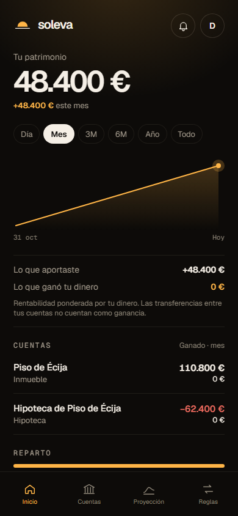

<p align="center"></p>

<h1 align="center">Soleva</h1>

<p align="center">Tu patrimonio, en piloto automático. Sin conectar el banco.</p>

<p align="center">
  <a href="https://github.com/jmartintechit-blip/soleva/actions/workflows/ci.yml"></a>
  <a href="https://github.com/jmartintechit-blip/soleva/releases"></a>
</p>

<p align="center"><a href="README.en.md">English</a></p>

Apuntas una vez cómo entra y sale tu dinero (nómina, aportaciones, gastos fijos) y Soleva te propone tus saldos cada mes y te enseña dónde estarás en 5, 10 o 20 años. Pensada para el inversor joven en España con varias cuentas, fondos o brókers.

> Soleva no mueve dinero, no se conecta a tu banco y no recomienda productos. Toda proyección es una estimación, no asesoramiento.

<p align="center"></p>

## Funcionalidades

Hoy (bloques 0 a 6 y 8 a 12):

- Portada pública con calculadora de interés compuesto en euros de hoy (escenarios 3, 6 y 8 % e inflación 2,5 %).
- Lista de espera con consentimiento y doble confirmación por email (abierta).
- Aviso legal, condiciones de uso y política de privacidad.
- Entrada sin contraseña con un código de 6 cifras por email.
- Rutas privadas con sesión, navegación inferior en móvil y lateral en escritorio.
- Cuentas y reglas: crear, editar, pausar, archivar y borrar; hoja «Nueva regla» con plantillas.
- Motor de reglas y proyección mes a mes por escenario, con tests de invariantes.
- Inicio y Proyección: patrimonio, evolución, escenarios, horizonte, «¿qué pasa si…?», supuestos editables y semáforo.
- Ajustes: tres temas, recordatorio, exportar todo en JSON o CSV, cerrar sesiones y borrar la cuenta de verdad.
- Sistema de diseño Horizonte, oscuro, con fuentes alojadas en el propio sitio.
- Base de datos del libro de movimientos (v0.8.0), motor diario (v0.9.0) y datos y ejecución diaria (v0.10.0): movimientos generados cada día, intereses sobre el saldo real, deudas, dividendos, valoración, rentabilidad, alertas, cierres de bolsa, tipos del BCE, Euríbor oficial y tablas de Hacienda.
- Pantallas nuevas sobre el libro (v0.11.0): Inicio con lo que aportaste frente a lo que ganó tu dinero por periodo, Alertas, Cuenta con posiciones y movimientos, Añadir producto (buscador con ISIN y bolsas), Cuadre con lo real y Alta inicial en tres pasos.
- Reglas y productos (v0.12.0): transferencias, ingresos, gastos y cuotas que generan movimientos; planes de inversión; cuenta remunerada con tramos; hipotecas y préstamos fijos o variables con su cuadro; vivienda por los m² de su municipio con el índice de precios del INE; coche por la tabla de Hacienda; bienes; productos sin precio público; baja, «Deshacer la baja» y borrado; y el paso de todos al libro al entrar, comprobado cuenta a cuenta. El cierre de mes da paso al cuadre, con un recordatorio mensual.

En camino antes de la beta: la proyección desde tus reglas, planes, deudas y depreciaciones, y el pulido (accesibilidad, rendimiento y app instalable).

## Stack

TypeScript · SvelteKit 3 + Svelte 5 · Cloudflare Workers · Neon Postgres (Frankfurt) con SQL a mano · Better Auth · Resend · Zod · Vitest + PGlite · Playwright.

Detalle en [ARCHITECTURE.md](ARCHITECTURE.md).

## Arrancarlo en local

Necesitas Node 24 y una base de datos de [Neon](https://neon.tech) (gratis).

```bash
npm ci
cp .dev.vars.example .dev.vars   # la app: DATABASE_URL y BETTER_AUTH_SECRET
cp .env.example .env             # los scripts: DATABASE_URL
npm run migrate
npm run dev
```

- `BETTER_AUTH_SECRET`: una cadena aleatoria de 32 caracteres o más (`openssl rand -base64 32`).
- `WAITLIST_OPEN=1` enseña el formulario de la lista de espera (en producción sigue apagado).
- `ALLOWED_EMAILS`: emails que pueden entrar, separados por comas (vacío = nadie; el registro está cerrado hasta la beta).
- Sin `RESEND_API_KEY`, el código de entrada sale en la consola de `npm run dev`.
- `npm test` no necesita claves: usa Postgres en memoria (PGlite).
- `npm run check` pasa lint, tipos, formato, tests y build, igual que el CI.
- `npm run e2e` prueba con Playwright la entrada, la lista de espera, la calculadora, cuentas y reglas, proyección, cierre de mes y ajustes contra la rama de `.env` (con `delivered@resend.dev` en `ALLOWED_EMAILS`); el CI lo corre en una rama temporal de Neon copiada de dev.

## Estado

En construcción: bloques 0 a 6 y 8 a 12 cerrados (v0.12.0), desplegado con el registro cerrado y la lista de espera abierta. El pulido (bloque 7) pasa al final, sobre las pantallas nuevas. Ver [CHANGELOG.md](CHANGELOG.md).

## Hoja de ruta

| Bloque                  | Contenido                                                   |
| ----------------------- | ----------------------------------------------------------- |
| 0 · Esqueleto           | Entrada, diseño, base de datos, seguridad, CI y despliegue  |
| 1 · Web pública         | Portada, calculadora de interés compuesto y lista de espera |
| 2 · Motor               | Reglas, cierre y proyección como funciones puras con tests  |
| 3 · Cuentas y reglas    | Crear, editar, pausar y borrar                              |
| 4 · Inicio y proyección | Patrimonio, gráfico y supuestos editables                   |
| 5 · Cierre de mes       | Propuesta, corrección, confirmación e histórico             |
| 6 · Ajustes             | Temas, exportar datos y borrar cuenta                       |
| 8 · Libro               | Modelo de datos de movimientos y paso de los datos actuales |
| 9 · Motor diario        | Movimientos generados cada día, intereses, deudas y alertas |
| 10 · Datos              | Precios, tipos de cambio, Euríbor y tablas de Hacienda      |
| 11 · Pantallas núcleo   | Inicio nuevo, cuentas con posiciones, cuadre y alertas      |
| 12 · Reglas y productos | Planes, deudas, vivienda, coche, bienes y paso al libro     |
| 13 · Proyección v2      | Proyección desde reglas, planes, deudas y depreciaciones    |
| 14 · Pulido             | Accesibilidad, rendimiento y app instalable (antes, 7)      |

## Seguridad

Ver [SECURITY.md](SECURITY.md) para avisar de una vulnerabilidad.

## Licencia

© 2026 Juan Antonio Martín Nadales. Todos los derechos reservados. El código es público para poder leerlo; ver [LICENSE](LICENSE).

Se desarrolla con asistencia de IA.
